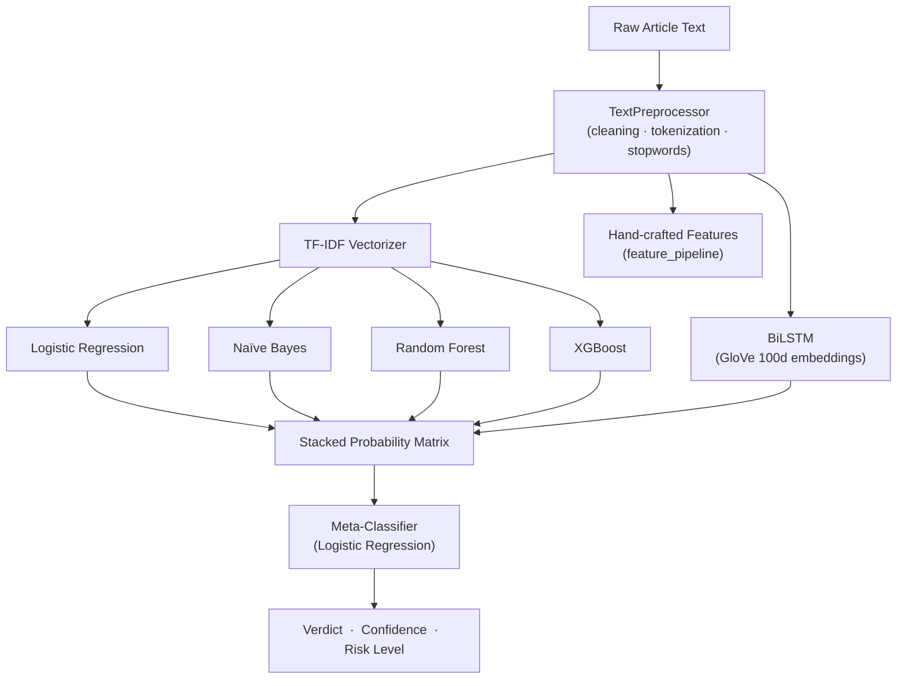

# 🛡️ Cernovalis — Fake News Detection System

> *"Discerning truth in the age of noise."*

Cernovalis is an end-to-end fake news detection platform combining a **stacked ensemble of classical ML and deep learning models** with a **real-time Next.js 15 web interface**. Paste any news article, get an instant REAL/FAKE verdict with confidence scores, linguistic flags, and per-model contributions — all explained.

---

## ✨ Features at a Glance

| Category | Capability |
|---|---|
| 🔍 **Detection** | Real-time single-article & batch-CSV analysis |
| 🤖 **ML Ensemble** | Logistic Regression · Naïve Bayes · Random Forest · XGBoost · BiLSTM |
| 🧩 **Stacking** | Meta-classifier trained on member probabilities |
| 📊 **Explainability** | Top feature impacts, linguistic flags, per-model contributions |
| 📈 **Analytics** | Local history with confidence-distribution charts and export |
| 🧪 **Testing** | pytest suite covering API, preprocessing, ML utilities, and models |
| 🎨 **UI** | Minimalist monochrome glassmorphism design with Framer Motion animations |

---

## 🗂️ Project Structure

```
Cernovalis/
├── backend/                        # FastAPI application + ML pipeline
│   ├── app/
│   │   ├── api/routes/             # REST endpoints
│   │   │   ├── analyze.py          # /analyze — single article
│   │   │   └── batch.py            # /batch   — CSV batch upload
│   │   ├── services/
│   │   │   ├── predictor.py        # Ensemble inference service
│   │   │   ├── explainer.py        # Feature attribution & linguistic flags
│   │   │   ├── analysis.py         # High-level analysis orchestration
│   │   │   └── preprocessor/       # Cleaning · tokenization · stopwords
│   │   ├── utils/
│   │   │   ├── bilstm.py           # BiLSTM model helpers
│   │   │   ├── ensemble.py         # Soft-vote & stacked matrix
│   │   │   ├── evaluation.py       # Metrics computation
│   │   │   ├── feature_pipeline.py # TF-IDF + hand-crafted feature fusion
│   │   │   ├── exporter.py         # Model-bundle export utilities
│   │   │   └── ...                 # error_analysis, baselines, etc.
│   │   ├── config.py               # Pydantic settings (env-driven)
│   │   ├── schemas.py              # Pydantic request / response models
│   │   └── main.py                 # FastAPI app with lifespan + CORS
│   ├── ml/
│   │   ├── data/raw/               # Fake.csv + True.csv (LIAR-style)
│   │   ├── data/processed/         # Cleaned articles + split indices
│   │   ├── models/saved/           # Trained model artefacts (.joblib / .keras)
│   │   ├── models/vectorizers/     # TF-IDF vectorizer
│   │   ├── models/embeddings/      # GloVe 100d embeddings
│   │   ├── notebooks/              # EDA + preprocessing explorations
│   │   ├── scripts/                # Training, evaluation & export scripts
│   │   └── reports/figures/        # Confusion matrices · ROC · PR curves
│   ├── tests/                      # pytest suite (17 test modules)
│   └── requirements.txt
│
└── frontend/                       # Next.js 15 application
    ├── app/
    │   ├── layout.tsx              # Root HTML shell + global providers
    │   ├── page.tsx                # Landing page (hero + starfield)
    │   ├── globals.css             # CSS reset + design-token variables
    │   └── (app)/                  # Authenticated app shell
    │       ├── layout.tsx          # App sidebar / header layout
    │       ├── detect/             # Article detection page
    │       ├── dashboard/          # Summary dashboard
    │       ├── analytics/          # Charts + history export
    │       ├── history/            # Full analysis history log
    │       ├── model-comparison/   # Side-by-side model metrics
    │       └── settings/           # User preferences (default model, etc.)
    ├── components/
    │   ├── ui/                     # Primitive UI components (Button, Tabs, GlassPanel…)
    │   ├── DataSphere.tsx          # Animated 3-D canvas sphere
    │   ├── BatchUpload.tsx         # Drag-and-drop CSV uploader
    │   ├── EmptyState.tsx          # Reusable empty-state placeholder
    │   ├── Explanation.tsx         # Feature impact + linguistic flag display
    │   ├── Verdict.tsx             # Verdict badge, risk chip, confidence gauge
    │   ├── HeroTypewriter.tsx      # Landing hero typewriter animation
    │   └── StarfieldBackground.tsx # Canvas starfield background
    └── lib/
        ├── api.ts                  # Axios client + typed API wrappers
        ├── schemas.ts              # Zod schemas + inferred TypeScript types
        ├── history.ts              # localStorage history store (hook + helpers)
        ├── metrics.ts              # Model option constants + default key
        ├── export.ts               # CSV & JSON history-export utilities
        └── cn.ts                   # clsx + tailwind-merge utility
```

---

## 🤖 ML Pipeline

### Model Ensemble



### Model Performance Summary

| Model | Accuracy | Precision | Recall | F1 |
|---|---|---|---|---|
| Logistic Regression | ~97 % | ~97 % | ~97 % | ~97 % |
| Naïve Bayes | ~94 % | ~94 % | ~94 % | ~94 % |
| Random Forest | ~98 % | ~98 % | ~98 % | ~98 % |
| XGBoost | ~99 % | ~99 % | ~99 % | ~99 % |
| BiLSTM | ~98 % | ~98 % | ~98 % | ~98 % |
| **Stacked Ensemble** | **~99 %** | **~99 %** | **~99 %** | **~99 %** |

> Figures are representative of evaluation on the processed dataset split. See `backend/ml/reports/figures/` for full confusion matrices, ROC curves, and precision-recall curves.

### Evaluation Figures

Confusion matrices and evaluation curves are generated automatically by the training scripts and saved to `backend/ml/reports/figures/`.

| Figure | Description |
|---|---|
| `roc_curves.png` | ROC curves for all member models |
| `precision_recall_curves.png` | Precision-recall curves per model |
| `*_confusion.png` | Raw confusion matrix per model |
| `*_confusion_norm.png` | Normalized confusion matrix per model |
| `*_feature_importance.png` | Top feature importance per classical model |

---

## 🖥️ App Pages

| Route | Description |
|---|---|
| `/` | Landing hero with typewriter animation and starfield background |
| `/(app)/detect` | Paste article text or upload a batch CSV for analysis |
| `/(app)/dashboard` | Summary statistics and recent activity |
| `/(app)/analytics` | Recharts visualizations — real vs fake over time, confidence distribution, error analysis |
| `/(app)/history` | Full paginated history of past analyses |
| `/(app)/model-comparison` | Side-by-side comparison of all loaded model metrics |
| `/(app)/settings` | Preferences: default model, UI options |

---

## 🔌 API Reference

Base URL: `http://localhost:8000`

### `GET /health`
Returns `{ "status": "ok" }` — useful for uptime checks.

### `POST /analyze`
Analyze a single article.

**Request body**
```json
{
  "text": "Paste the article body here…",
  "title": "Optional headline"
}
```

**Response (abbreviated)**
```json
{
  "verdict": "FAKE",
  "confidence": 0.94,
  "risk_level": "HIGH",
  "probability_real": 0.06,
  "model_probabilities": {
    "logistic_regression": 0.04,
    "naive_bayes": 0.09,
    "random_forest": 0.05,
    "xgboost": 0.03,
    "bilstm": 0.08
  },
  "explanation": {
    "top_features": [...],
    "linguistic_flags": [...],
    "model_contributions": [...]
  },
  "source_credibility": { "label": "UNKNOWN", "domain": null }
}
```

### `POST /batch`
Upload a CSV file with a `text` column (and optional `title` column) for batch analysis. Returns a JSON array of results.

---

## ⚙️ Tech Stack

### Backend
| Layer | Technology |
|---|---|
| Web framework | FastAPI 0.110+ · Uvicorn · Python 3.13 |
| ML / NLP | scikit-learn · XGBoost · TensorFlow/Keras · NLTK · spaCy |
| Feature engineering | TF-IDF · GloVe 100d · hand-crafted linguistic features |
| Data | pandas · NumPy |
| Serialization | Pydantic v2 · pydantic-settings |
| Testing | pytest · pytest-asyncio · httpx |
| Logging | Loguru |

### Frontend
| Layer | Technology |
|---|---|
| Framework | Next.js 15 · React 19 · TypeScript 5 |
| Styling | Tailwind CSS 3 · tailwind-merge · clsx |
| Animation | Framer Motion 12 |
| Charts | Recharts 3 |
| Validation | Zod 3 |
| Icons | Lucide React |
| HTTP client | Axios |

---

## 🚀 Getting Started

### Prerequisites

- Python 3.11+ and `pip`
- Node.js 20+ and `pnpm` (or `npm`)

### 1 — Clone & install

```bash
git clone https://github.com/<your-org>/cernovalis.git
cd cernovalis
```

#### Backend
```bash
cd backend
python -m venv .venv
# Windows
.venv\Scripts\activate
# macOS / Linux
source .venv/bin/activate

pip install -r requirements.txt
```

#### Frontend
```bash
cd frontend
pnpm install        # or: npm install
```

### 2 — Train models (first run)

```bash
# From the repo root, with the backend venv active:
python -m backend.ml.scripts.make_splits
python -m backend.ml.scripts.train_tfidf
python -m backend.ml.scripts.train_features
python -m backend.ml.scripts.train_baselines
python -m backend.ml.scripts.train_forest
python -m backend.ml.scripts.train_xgboost
python -m backend.ml.scripts.train_bilstm
python -m backend.ml.scripts.train_ensemble
python -m backend.ml.scripts.evaluate_models
python -m backend.ml.scripts.export_artifacts
```

> Skip this step if you already have artefacts in `backend/ml/models/saved/`.

### 3 — Run the backend

```bash
# From the repo root:
uvicorn backend.app.main:app --reload --port 8000
```

### 4 — Run the frontend

```bash
cd frontend
pnpm dev        # starts on http://localhost:5173 (or 3000)
```

Open `http://localhost:5173` in your browser.

---

## 🧪 Running Tests

```bash
cd backend
pytest tests/ -v
```

The suite covers API endpoints, preprocessing, ML utilities, model training helpers, and the export bundle.

---

## 📁 Data

The raw dataset lives in `backend/ml/data/raw/` as `Fake.csv` and `True.csv` (LIAR-style labelled articles). These are gitignored by default — add your own copies or adjust the paths in the training scripts.

---

## 🗺️ Roadmap

- [ ] URL scraping support in the Detect page
- [ ] User authentication & server-side history persistence
- [ ] Live model retraining via the settings UI
- [ ] Docker Compose deployment configuration
- [ ] Real-time streaming inference via WebSocket

---

## 📜 License

This project is for research and educational purposes. See [`LICENSE`](./LICENSE) for details.

---

<div align="center">
  <sub>Built with ☕ and a healthy distrust of unverified headlines.</sub>
</div>
